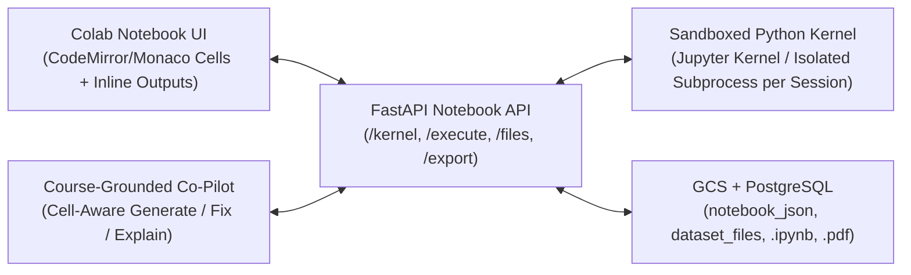

# Plan: Full-Fledged LectureScribe Colab (Interactive Notebook Studio)

## Vision
Transform the Notebook view in Assignment Studio into a complete, course-grounded **interactive Jupyter/Colab environment** where students can write, edit, reorder, and execute Python + Markdown cells interactively with persistent kernel state, inline outputs (stdout, DataFrames, Matplotlib/Seaborn plots, LaTeX), dataset uploads, and Co-Pilot assistance—while keeping one-click `.ipynb` and PDF export.

---

## Architecture Overview

---

## Phased Implementation Roadmap

### Phase 1: Interactive Cell Editor & Inline Execution Outputs (High Impact, Low Risk)
- **Canonical Notebook State (`cells[]`)**: Store structured `notebook_json` (nbformat v4) alongside `draft_markdown` on `lecturescribe_course_assignments` so cell metadata, execution counts, and outputs persist across refreshes.
- **Per-Cell Run & Run All**:
  - Add a **Play (`▶`)** button on every Python code cell, plus **Run All**, **Clear Outputs**, **+ Code**, **+ Markdown**, reorder (↑/↓), and delete cell actions.
  - Render real Jupyter outputs directly beneath each code cell:
    - `stream` (`stdout` / `stderr`)
    - `execute_result` / `display_data` (`text/plain`, `text/html` DataFrames, `image/png` Matplotlib/Seaborn charts)
    - `error` (formatted Python traceback with a one-click **"Fix with Co-Pilot"** button)
- **Code Editor Upgrade**: Replace plain `<pre>` with a lightweight syntax-highlighted editor (e.g., CodeMirror 6 with Python + Markdown modes, `Shift+Enter` to run cell and advance).

### Phase 2: Persistent Session Kernel & Sandboxed Execution
- **Per-Session Python Runtime**:
  - Move from stateless one-shot `exec(...)` to a persistent per-session Jupyter kernel (`jupyter_client` / `ipykernel`) or isolated worker container with:
    - Variable persistence across individual cell runs (`In [1]` → `In [2]` without re-running everything).
    - **Restart Kernel**, **Interrupt Execution**, and idle timeout cleanup (e.g., 15 min idle TTL).
    - Resource limits (CPU, memory cap, execution timeout per cell, restricted filesystem/network sandbox) so untrusted/buggy student code cannot crash or compromise the backend.
- **Streaming Outputs (SSE / WebSocket)**: Stream `print()` logs and progress bars live while long-running training loops execute.

### Phase 3: Workspace Files & Dataset Mounting
- **Files Sidebar (Colab-style)**:
  - Upload CSV/TSV/JSON/Excel/ZIP datasets directly into the session's working directory (persisted in GCS and synced to the kernel's `work_dir` on startup).
  - Preview CSV columns/rows and let the Co-Pilot inspect uploaded dataset schemas automatically so generated code uses exact filenames and column names.
  - Allow downloading files generated by code cells (e.g., cleaned CSVs, saved plots).

### Phase 4: Cell-Aware Co-Pilot & Course Grounding
- **Targeted Cell Actions**:
  - **"Fix Error with Co-Pilot"**: sends the failing cell code + traceback + surrounding cell context to the Co-Pilot and applies a clean diff to that cell.
  - **"Explain Cell"** / **"Add Visualization"** / **"Optimize"** inline actions per cell.
- **Diff & Undo**: Keep per-cell edit history so students can accept/revert Co-Pilot edits safely.

### Phase 5: Deliverables & LMS Integration
- **One-Click Exports**:
  - **Download `.ipynb`** (complete with executed outputs & embedded plots).
  - **Export Executed PDF** (via existing `render_notebook_to_html` + WeasyPrint so plots and tables render cleanly in PDF).
  - **Submit to Course Assignment**: directly attach the executed `.ipynb` to the student's LMS assignment submission.

---

## Suggested Starting Point
**Phase 1** can be built directly on top of what we just shipped (`compile_studio_ipynb` + `execute_code_cells` + `AssignmentStudio.jsx`) with zero new infrastructure—giving you editable cells, `▶ Run` / `Run All`, inline stdout + Matplotlib plots, and **"Fix with Co-Pilot"** on errors immediately.
