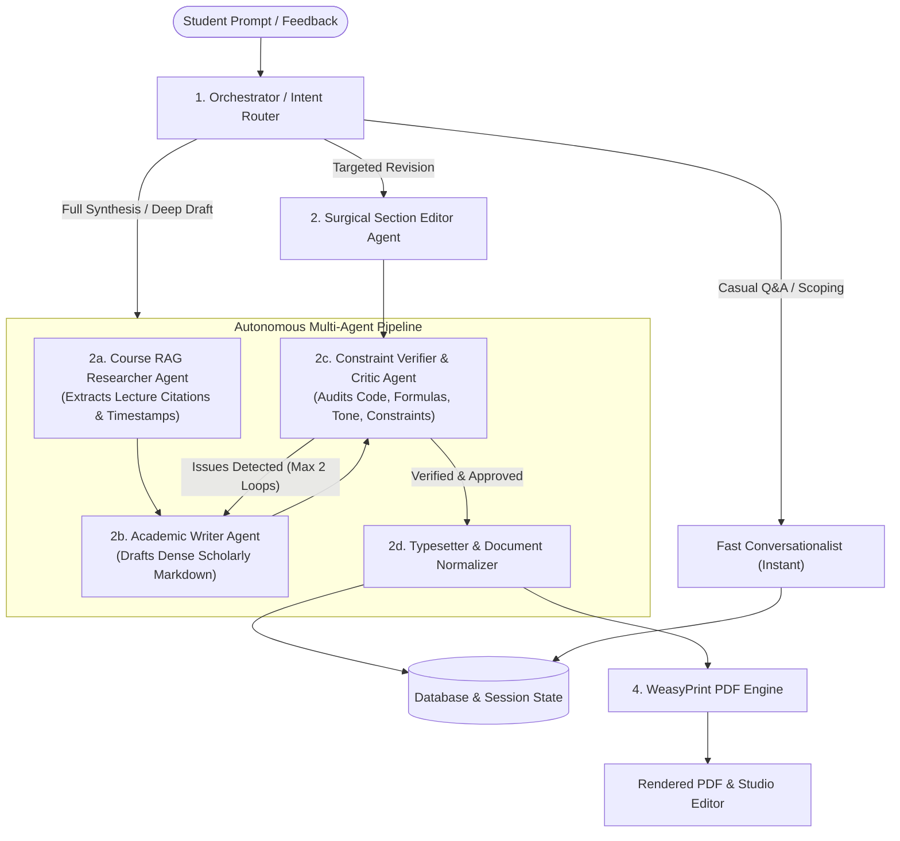

# Architectural Plan: Multi-Agent Assignment Studio for LectureScribe

## 1. Executive Summary & Problem Analysis

The current **Assignment Studio** employs a single-turn, monolithic LLM prompt that simultaneously acts as a conversational partner, course researcher, academic writer, proofreader, and typesetter. While functional for short discussions, this single-prompt model degrades on long-form academic documents (3,000–5,000+ words), causing:

1. **Negative Constraint Amnesia**: When instructed to *"remove all Python code"* or *"remove mathematical equations"*, attention is diluted across 5+ pages, causing negative constraints to be ignored or only partially applied.
2. **Whole-Document Regeneration Inefficiency**: Modifying a single sentence in Section 3 requires rewriting the entire document, which introduces accidental regressions in Sections 1 and 2 and wastes tokens.
3. **Lack of a Verification Gate**: Formatting anomalies (such as raw markdown `---` dividers or unrendered LaTeX `\Delta_{\text{lead}}`) slip into the final PDF because no critic validates the output before presentation.
4. **Opaque Student Experience**: Long generation times leave the student staring at an indeterminate spinner with no insight into what is happening.

### Core Objective
Transition Assignment Studio to an **orchestrated multi-agent system** with specialized, role-bound agents, structured document memory (section-level state), a deterministic **Critic/Verifier** loop, and transparent progress streaming.

---

## 2. Multi-Agent System Architecture



---

## 3. Specialized Agent Roles & Responsibilities

### Agent 1: Orchestrator / Intent Router
- **Role**: Fast intent classification and workflow dispatch.
- **Model**: Lightweight fast model (`gemini-flash-lite` / `groq-llama-3-8b`).
- **Actions**:
  - `DISCUSS`: Student is asking concept questions or scoping requirements $\rightarrow$ fast chat, no document edit.
  - `GENERATE_DRAFT`: Student triggers initial document synthesis $\rightarrow$ dispatch to Pipeline.
  - `SURGICAL_EDIT`: Student requests targeted modification (*"change section 4.2 to add weekly meetings"*) $\rightarrow$ dispatch to Section Editor.
  - `COMPILE`: Student requests PDF re-compilation $\rightarrow$ dispatch to Typesetter.

### Agent 2: Course RAG Researcher
- **Role**: Grounding and evidence extraction.
- **Tools**: Pinecone vector search, lecture transcript parser, course syllabus lookup.
- **Output**: Structured citation context (exact lecture numbers, timestamps, and key verbatim concepts) passed to the Writer.

### Agent 3: Academic Writer Agent
- **Role**: Generating rigorous, scholarly prose structured by academic conventions (IEEE/ACM/Nature standards).
- **Behavior**: Writes clean Markdown with explicit LaTeX math delimiters (`$...$`, `$$...$$`), standard tables, and grounded arguments.

### Agent 4: Surgical Section Editor Agent
- **Role**: Localized patching of existing documents.
- **Mechanism**:
  - Breaks the document into an internal `sections_map` (e.g., `{"1. Abstract": "...", "2. Methodology": "...", ...}`).
  - Identifies which section(s) need updates.
  - Patches only the targeted section, preserving 100% of the untargeted text without token loss or hallucination.

### Agent 5: Constraint Verifier & Critic Agent (The Quality Gatekeeper)
- **Role**: Audits generated content before the student ever sees it.
- **Audit Checklist**:
  1. **Cumulative Negative Constraints**: If student said *"no python code"*, ensure 0 triple-backtick code blocks. If *"no mathematical formulas"*, verify no unrendered equations.
  2. **Cumulative Positive Constraints**: Verify presence of mandatory elements (e.g., *"Dr. Manjunath"*, *"4-semester trajectory"*, *"weekly sync protocol"*).
  3. **Typesetting & Syntax**: Detect unescaped LaTeX math (`\Delta_{\text{lead}}` vs `$\Delta_{\text{lead}}$`), table column misalignments, or raw `---` lines.
- **Outcome**: If checks pass $\rightarrow$ approve. If checks fail $\rightarrow$ return feedback diff to Writer (capped at max 2 iterations).

### Agent 6: Typesetter & PDF Compiler
- **Role**: Normalizes document HTML and compiles the academic PDF.
- **Behavior**: Applies typographic CSS, suppresses unwanted separator tags, renders clean subscript/superscript markup (`Δ<sub>lead</sub>`), and builds the PDF via WeasyPrint.

---

## 4. Shared State & Memory Architecture

```python
class StudioAgentState(TypedDict):
    session_id: str
    course_name: str
    problem_statement: str
    title: str
    author: str
    
    # Structured Document State
    draft_markdown: str
    sections_map: Dict[str, str]       # {"Abstract": "...", "3. Methodology": "..."}
    
    # Context & Constraints
    chat_history: List[Dict[str, Any]]
    active_constraints: List[str]      # ["no_python_code", "mentor: Dr. Manjunath", "no_date_header"]
    course_citations: List[Dict[str, Any]]
    
    # Execution Tracking
    current_agent: str
    thought_stream: List[str]          # User-facing progress milestones
    iteration_count: int               # Self-correction loop guard (max 2)
```

---

## 5. Phased Implementation Roadmap

### Phase 1: The Verifier Gatekeeper (Immediate High-Value Win)
- **Goal**: Stop formatting bugs, leaked syntax, and violated negative constraints immediately.
- **Tasks**:
  1. Implement `run_constraint_verifier(draft, constraints, chat_history)` in `backend/assignment_studio_service.py`.
  2. Extract cumulative constraints automatically from user messages (e.g., detecting "no code", "no formulas", "include mentor").
  3. Hook the Verifier into `generate_first_draft` and `refine_existing_draft`.
  4. Write unit tests in `backend/tests/test_assignment_studio.py`.

### Phase 2: Surgical Section Editor (Token Efficiency & Continuity)
- **Goal**: Eliminate whole-document regeneration when only a specific section is changed.
- **Tasks**:
  1. Add a markdown section parser (`parse_markdown_sections`) and reconstructor (`join_markdown_sections`).
  2. Implement `surgical_section_edit` which prompts the LLM with only the relevant section and returns a targeted replacement.
  3. Seamlessly merge modified sections into `draft_markdown`.

### Phase 3: Autonomous Course RAG Researcher
- **Goal**: High-fidelity course grounding with verified timestamps.
- **Tasks**:
  1. Connect `gather_course_knowledge` directly to Pinecone search with score filtering ($>0.72$).
  2. Format retrieved chunks into verified lecture references `[Lecture X, MM:SS]`.
  3. Pass retrieved evidence to the Writer agent.

### Phase 4: Frontend Thought Stream & Progress Milestones
- **Goal**: Transparent, engaging user experience during multi-agent execution.
- **Tasks**:
  1. Stream agent milestone events over SSE or WebSocket (e.g., `🔍 Searching course lectures...`, `✍️ Drafting methodology...`, `🛡️ Verifying student constraints...`, `📄 Compiling PDF...`).
  2. Render animated status pills in `frontend/src/components/course/AssignmentStudio.jsx`.

---

## 6. Risk Analysis & Mitigations

| Risk | Impact | Mitigation Strategy |
| :--- | :--- | :--- |
| **Increased Latency** | Multi-agent handoffs take longer than single prompts. | Use ultra-fast flash models for Router and Verifier (<500ms). Stream visible progress milestones to the UI so the wait feels productive. |
| **Infinite Critique Loops** | Writer and Verifier disagree repeatedly. | Hard cap of `max_iterations = 2`. If iteration 2 fails, accept the best draft and log warnings. |
| **Section Parser Brittleness** | Non-standard markdown headings (# vs ##). | Fall back to whole-document edit if section headings are ambiguous or absent. |
| **Breaking API Compatibility** | Existing frontend expects `{draft_markdown, reply}`. | Maintain identical REST API response contracts so frontend continues working without breaking changes. |
